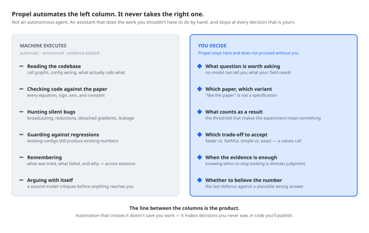
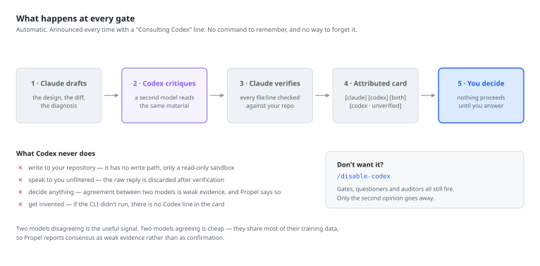
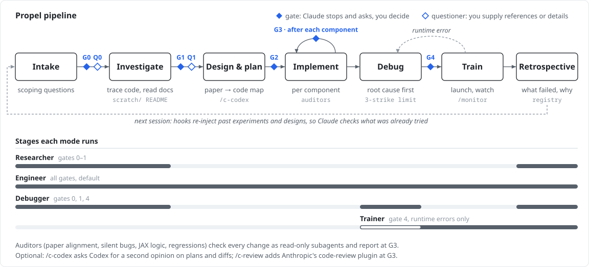

# Propel

**Propel is not an autonomous agent.** It automates the mechanical half of research
engineering (tracing code, checking implementations against the paper, hunting
silent bugs, remembering what already failed) and stops at every decision that is
yours.

**[Website](https://kbian.org/propel-website/)** | **[Documentation](https://kbian.org/propel-website/docs/)** | **[Vibe Coding Articles](https://kbian.org/Kaiwen-Wiki/articles/vibe_coding/)**

<p align="center">
  
</p>

## Why

An unconstrained LLM writes the mean of its training data: ask for "a diffusion
policy head" and you get a blend of every diffusion codebase it has seen, not the
variant your paper describes. In research code that mistake is quiet: a
broadcasting bug in a loss doesn't crash, it gives you wrong numbers and a plot you
believe.

Propel adds structure instead of a cleverer prompt. The agent investigates before
it writes code, stops at five gates to ask you design questions, sends every change
past auditors that compare it against the paper, and consults a second model
(OpenAI Codex) before anything reaches you. Retrospectives feed a working memory
that the next session loads, so failed ideas are not proposed twice.

You never pick a mode, name a skill or ask for a second opinion: Propel infers the
mode from your first message, dispatches skills and auditors itself, and says what
it picked.

## Two models at every decision

<p align="center">
  
</p>

Codex reviews the design, the diff or the diagnosis at every gate. Claude checks
every `file:line` Codex cites against your repository and labels each finding
`[claude]`, `[codex]`, `[both]` or `[codex · unverified]`. Codex never decides and
never writes to your repo; `/disable-codex` turns it off.

Two records are written by scripts, not by the model, so you can check them:

```bash
propel codex log    # every Codex consult: what was asked, when, what came back
propel tasks        # training runs, monitored runs and plan tasks still open (--all for finished ones)
```

## Pipeline and modes

<p align="center">
  
</p>

| Mode | Gates | Picked when |
|------|-------|-------------|
| **Researcher** | 0, 1 | The question is about the problem space, not the code |
| **Engineer** | 0–4 | There is something to build (also the fallback) |
| **Debugger** | 0, 1, 4 | There is a specific wrong behavior to explain |
| **Trainer** | 4 (runtime) | The code is settled; the problem is execution |

Propel announces the mode it picked and switches on its own when the work changes.
Override with `/switch <mode>`.

## Install

```bash
git clone https://github.com/KevinBian107/propel.git && cd propel

# one of:
pip install -e .                                              # inside an activated conda env or virtualenv
uv venv && source .venv/bin/activate && uv pip install -e .   # a uv venv in the clone
uv tool install --editable .                                  # uv, isolated, `propel` on PATH everywhere

propel   # installs Claude Code and Codex if missing, signs you in, sets up your project
```

`propel` opens a setup page in your browser on a laptop, and asks in the terminal
on a cluster (sign-in there uses a device code you approve on any device). Never
run plain `pip install` outside an activated env: on a Homebrew or system Python it
fails with `externally-managed-environment`. Then start `claude` and describe what
you're working on.

## Update

```bash
propel status             # installed vs available version, and what would change
propel update --dry-run   # preview
propel update             # pull Propel, reinstall if needed (pip or uv), refresh this project
```

Your own skills, agents, commands, hooks, `CLAUDE.md` and permissions are kept.
Propel's bundled files are replaced, and any you edited are backed up to
`.propel/backup/` first. Restart open Claude Code sessions when it tells you to.
Details: [Getting Started](https://kbian.org/propel-website/docs/getting-started.html#updating).

## Documentation

[Getting Started](https://kbian.org/propel-website/docs/getting-started.html) ·
[Core Principles](https://kbian.org/propel-website/docs/core-principles.html) ·
[Automation](https://kbian.org/propel-website/docs/automation.html) ·
[Codex](https://kbian.org/propel-website/docs/codex.html) ·
[Pipeline](https://kbian.org/propel-website/docs/pipeline/) ·
[Modes](https://kbian.org/propel-website/docs/modes/) ·
[Skills](https://kbian.org/propel-website/docs/skills/) ·
[Agents](https://kbian.org/propel-website/docs/agents/) ·
[Customization](https://kbian.org/propel-website/docs/customization.html) ·
[Common Pitfalls](https://kbian.org/propel-website/docs/pitfalls.html)

Figures are generated by the scripts in [`figures/`](figures/)
(`python figures/make_all.py`); the SVGs in `assets/` are build output.

## Acknowledgments

Propel combines ideas from [obra/superpowers](https://github.com/obra/superpowers), [scott-yj-yang/new-prompt](https://github.com/scott-yj-yang/new-prompt), [Talmo's sleap-io](https://github.com/talmolab/sleap-io), [Sionic AI](https://huggingface.co/blog/sionic-ai/claude-code-skills-training), [brunoasm's claude skills](https://github.com/brunoasm/my_claude_skills), [Weizhena's Deep-Research](https://github.com/Weizhena/Deep-Research-skills) and [Context Engineering Template](https://github.com/coleam00/context-engineering-intro). Figure conventions follow [ChenLiu-1996/figures4papers](https://github.com/ChenLiu-1996/figures4papers). The dual-model layer drives the [OpenAI Codex CLI](https://developers.openai.com/codex/cli); `/c-review` bridges the [Claude Code code-review plugin](https://github.com/anthropics/claude-code/tree/main/plugins/code-review). Vendored skill: [anthropics/skills frontend-design](https://github.com/anthropics/skills/blob/main/skills/frontend-design/SKILL.md) (see its repo for the license).

## License

MIT. Built by [Kaiwen Bian](https://kbian.org) and [Yuer Tang](https://yuertang.dev/).
